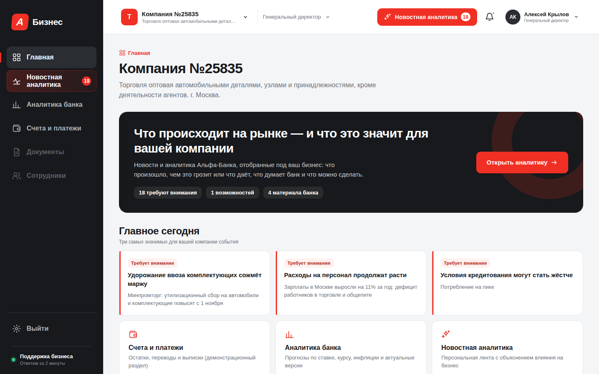
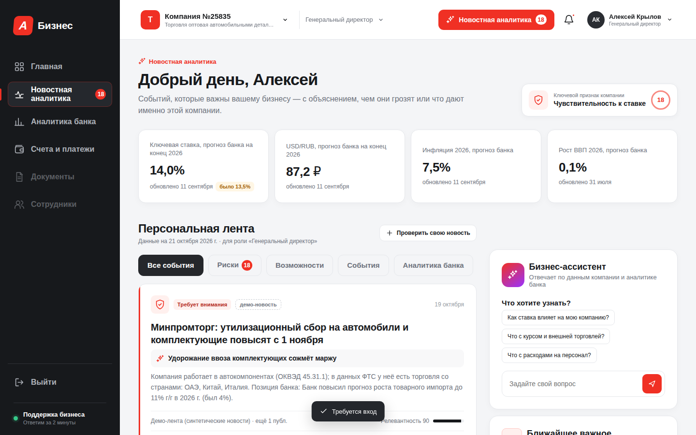
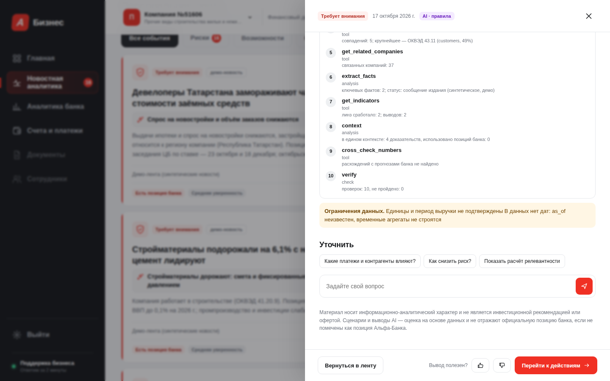
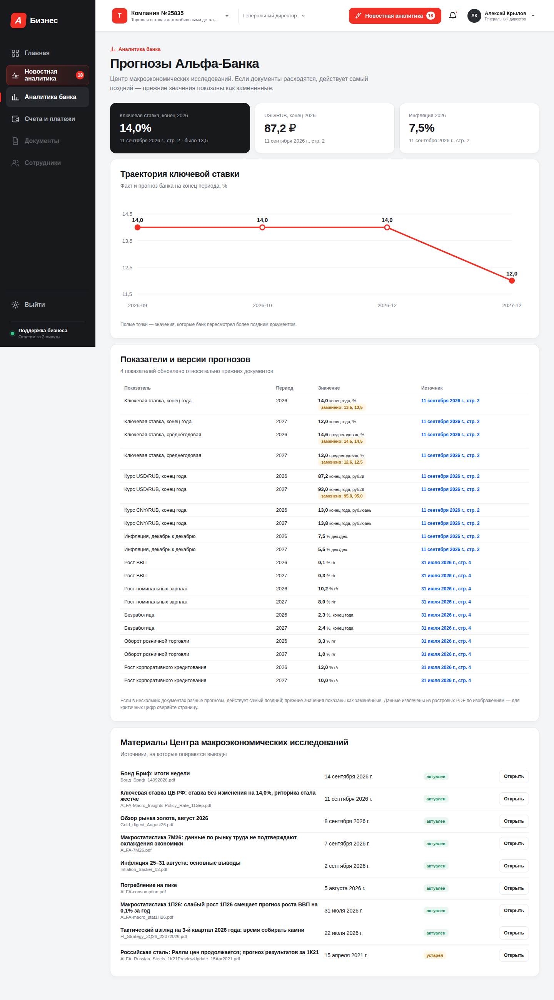
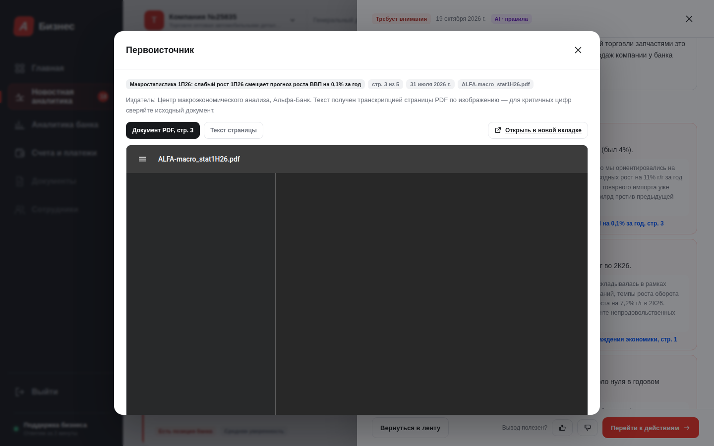
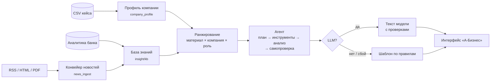

<div align="center">

# Alfa Insight

**Персональная новостная аналитика для руководителей крупного бизнеса в интернет-банке «А-Бизнес»**


[Быстрый старт](#-быстрый-старт) · [Как это работает](#-как-это-работает) · [Критерии кейса](#-соответствие-критериям-кейса) · [Исправления](#-исправления-после-полного-дебага-160) · [LLM](#-режимы-правила-и-llm) · [Данные](#-данные) · [Тесты](#-тесты)



</div>

---

## 💡 Идея

Сервис определяет бизнес-контекст компании, отбирает значимые события из внешних новостей и аналитики Альфа-Банка и **объясняет их влияние именно на эту компанию**: что произошло, почему важно, какие риски и возможности, что думает банк, что можно сделать и на чём основан вывод.

> **Это не пересказ новостей.** Новость «ЦБ сохранил ставку 14%»
> — для компании с кредитами и лизингом превращается в вывод: *«деньги остаются дорогими, нагрузка по долгу не снизится до конца 2026 г. (прогноз банка от 11.09, стр. 2); на каждые 100 млн ₽ плавающего долга ±1 п.п. ставки — ±1 млн ₽ в год»*;
> — для компании с депозитами — в возможность разместить остатки с учётом ближайшего заседания ЦБ.

<table>
  <tr>
    <td width="50%"><br><sub><b>Лента</b> — события, отобранные под компанию и роль</sub></td>
    <td width="50%"><br><sub><b>Разбор</b> — шесть блоков с источниками и метками происхождения</sub></td>
  </tr>
  <tr>
    <td><br><sub><b>Аналитика банка</b> — прогнозы и их версии</sub></td>
    <td><br><sub><b>Первоисточник</b> — PDF на нужной странице и текст рядом</sub></td>
  </tr>
</table>

---

## 🚀 Быстрый старт

> **Вход:** логин `demo`, пароль `demo` — пользователь с 6 компаниями.
> Другие демо-пользователи (CFO, казначей, главный бухгалтер, собственник) — на экране входа и в меню аватара (правый верхний угол): там же смена роли и выход.

<details open>
<summary><b>🪟 Windows (без Docker)</b></summary>

1. Установить [Python 3.12](https://www.python.org/downloads/release/python-3129/) с галочкой «Add python.exe to PATH».
2. Распаковать архив целиком и дважды щёлкнуть `start.bat`.

Скрипт найдёт Python, поставит зависимости (первый раз 1–2 минуты), запустит сервер и откроет браузер — http://localhost:8080 (если порт занят — `:8090`). Окно с сервером не закрывать.
</details>

<details>
<summary><b>🍎 macOS / 🐧 Linux (без Docker)</b></summary>

```bash
./start.sh        # нужен Python 3.12 → http://localhost:8080
```
</details>

<details>
<summary><b>🐳 Docker</b></summary>

```bash
cp .env.example .env
docker compose up --build            # → http://localhost:8080
```
</details>

<details>
<summary><b>🛠 Вручную</b></summary>

```bash
python3.12 -m pip install -r requirements.lock.txt
python3.12 -m services.insight.server
```
Запускать тем же Python 3.12, которым ставились зависимости (на Windows: `py -3.12 …`).
</details>

<details>
<summary><b>🎨 Пересборка интерфейса</b></summary>

Интерфейс уже собран в `frontend/dist`. Пересборка (Node.js 24):

```bash
cd frontend && corepack pnpm install --frozen-lockfile && corepack pnpm build
```

Разработка: запустить Python-сервер, затем `corepack pnpm dev` (порт 8443; `/api` проксируется на `:8080`, см. `vite.config.ts`). Резервная сборка без npm-реестра — `frontend/build.sh` (нужен `esbuild`).
</details>

> [!TIP]
> Версия видна внизу бокового меню. Если после обновления интерфейс выглядит старым — закройте старое окно сервера и нажмите **Ctrl+F5**.

### Новости: живые ленты и офлайн-режим

| Режим | Как включить | Что в ленте |
|---|---|---|
| **Живые ленты** (по умолчанию) | — | Реальные RSS (Банк России, Интерфакс, РБК, ТАСС), обход каждые 30 минут; первые материалы — через 1–2 минуты после старта. Опорная дата — сегодня. Свежесть — `/api/health` → `kb.feeds` |
| **Офлайн** | `ALFA_LIVE_FEEDS=0` в `.env` или окружении | Синтетические новости из `data/news_demo/`, воспроизводимый сценарий [`docs/DEMO_SCRIPT.md`](docs/DEMO_SCRIPT.md) на дату 21.10.2026 |

Синтетические демо-новости в режиме живых лент не показываются: рядом с реальными вымышленные события вводили бы в заблуждение. Список источников — `services/news_ingest/config/sources.yaml`.

Публикация на сервере — [`docs/DEPLOY.md`](docs/DEPLOY.md).

---

## 🧠 Как это работает



| Слой | Где | Что делает |
|---|---|---|
| Профиль компании | `services/company_profile/` | Признаки чувствительности (ставка, ВЭД/курс, ФОТ, спрос, цепочка поставок), ОКВЭД, регион, группа, платежи. Источник — CSV кейса |
| Новости и аналитика | `services/news_ingest/` | RSS, HTML, текст, PDF-сайдкары; дедупликация, темы, отрасли, регионы, числовые прогнозы банка, фильтр prompt-injection |
| **Ранжирование** | `services/insight/ranking.py` | Объяснимая оценка релевантности «материал × компания × роль» |
| **Анализ влияния** | `services/insight/lenses.py` | «Линзы»: ставка, депозиты, курс/ВЭД, ФОТ, спрос, макро, отраслевые сценарии, цепочка поставок |
| **Агент** | `services/insight/agent.py` | План → инструменты → единый контекст → анализ → синтез → самопроверка → адаптация, трассировка |
| База знаний | `services/insight/kb.py` | 21 «якорная» позиция банка, проверенная по тексту страницы; прогнозы с версиями; BM25-поиск; календарь |
| LLM | `services/insight/llm.py` | Только разрешённые модели, дневной бюджет, кеш, откат на правила |
| Вопросы | `services/insight/qa.py` | Уточняющие вопросы: платежи, расчёт релевантности, действия, прогнозы, поиск по материалам |
| API и сервер | `services/insight/server.py` | REST, демо-вход, права доступа, аудит, лимит запросов, раздача интерфейса |
| Интерфейс | `frontend/` | React + TypeScript, оформление в стиле «А-Бизнес», палитра кейса |

📐 Подробнее: [`docs/architecture.md`](docs/architecture.md), [`docs/MONITORING_AND_SCALING.md`](docs/MONITORING_AND_SCALING.md). OpenAPI — `GET /api/openapi.json`.

---

## ✅ Соответствие критериям кейса

| № | Критерий | Как реализовано |
|:-:|---|---|
| 1 | Бизнес-контекст и отбор | Профиль из CSV → `sensitivity_factors`, темы с весами, ОКВЭД-иерархия; ранжирование показывает вклад каждого признака («Показать расчёт релевантности») |
| 2 | Содержательная интерпретация | Шесть блоков: что произошло / почему важно / последствия (риски, возможности, сценарии) / оценка банка / действия / основание. Отраслевые сценарии: импорт запчастей, строительство, общепит, аренда, упаковка |
| 3 | Банк vs AI | Метки у каждого утверждения: «Позиция Альфа-Банка», «Данные из аналитики банка», «Факт из новости», «Данные о компании», «Вывод AI», «Не подтверждено». Позиция банка — только чанки `bank_view` и якоря со ссылкой на страницу |
| 4 | Корректность и первоисточники | Каждый вывод ссылается на доказательства (`E1…`) с документом и страницей; проверка «числа в выводах есть в источниках»; при конфликте прогнозов действует поздний, прежние показаны |
| 5 | Устойчивость на новых новостях | Живые ленты по расписанию; отраслевые сценарии срабатывают только при подтверждении в тексте события; новости без конкретного вывода для компании в ленту не попадают; «Проверить свою новость» прогоняет текст через весь конвейер |
| 6 | Полный сценарий | Вход → главная → лента → разбор → действие (менеджер / звонок / заявка) |
| 7 | Масштабирование | Новая отрасль, источник или тема — YAML-правила; профили строятся для любой из 85 тыс. компаний |
| 8 | Метрики и мониторинг | `GET /api/metrics`, обратная связь 👍/👎, скрытые события, свежесть лент в `/api/health` |
| 9 | Точка входа на главном экране | Баннер на «Главной», пункт меню с бейджем и кнопка в шапке — с любого экрана |
| 10 | Взаимодействие с аналитикой | Вопросы по инсайту и ассистент, «Аналитика банка», «Открыть первоисточник» (текст страницы / PDF), «Скрыть» с возвратом из списка скрытых |
| 11 | Агентная логика | План, инструменты (только чтение), общий контекст, самопроверка (11 проверок) и адаптация — видно в блоке «Действия агента» |
| 12 | Трассировка | Доказательства, признаки компании (`rule_id` + строки CSV), проверки, шаги агента с длительностью |

---

## 🛠 Исправления после полного дебага (1.6.0)

Полный прогон сценариев выявил выводы, которые звучали убедительно, но не следовали из источника. Исправлено:

| Было | Стало |
|---|---|
| Рост цен на бензин превращался в вывод «дорожает доставка» | Сценарий логистики срабатывает только при прямом упоминании роста тарифов, стоимости перевозок, доставки или фрахта |
| Новость о **снижении** цен на продукты давала вывод «продукты дорожают» для общепита и оптовой торговли | Сценарии роста цен на продукты пропускаются, если в тексте говорится о снижении |
| Случайное упоминание валюты в тексте давало вывод о курсе | Курсовая линза требует заметного веса темы `fx_rates` (≥ 0,2) |
| Действия по курсу были одинаковыми для всех ролей | Свои действия у генерального директора (план и цены), финансового директора (потоки и бюджет), главного бухгалтера (учёт валютных операций), казначея (валютная позиция и платежи) |
| 10 самопроверок | 11: новая проверка **«Смысл выводов соответствует источникам»** — неподтверждённый вывод удаляется при адаптации, причина видна в «Действиях агента» |

Плюс: иконка вкладки — фирменная «A» вместо значка Figma. Подробности — в [`CHANGELOG.md`](CHANGELOG.md).

---

## 🤖 Режимы: правила и LLM

Без `LLM_BASE_URL` / `LLM_API_KEY` сервис полностью детерминирован («AI · правила»): тексты выводов собираются из проверяемых данных.

**Подключение шлюза.** `cp .env.example .env` и вписать ключ в `LLM_API_KEY`. Адреса и идентификаторы моделей уже заполнены. `start.bat` / `start.sh` и ручной запуск читают `.env` при старте (переменные окружения важнее файла), docker compose — через `env_file`. Проверка: `/api/health` → `llm.configured: true`, в журнале — «режим: llm».

| Где | Модель | Что делает |
|---|---|---|
| Разбор события | `reason` — `z-ai/glm-5.3-flash` | Переписывает краткий текст и выводы для компании. Сначала мгновенно показывается разбор по правилам, затем (≈ 8 с) тексты заменяются ответом модели |
| Лента | `reason` | Три верхние карточки (`LLM_PREWARM`) переписываются в фоне. Тип, значимость и релевантность — всегда по правилам |
| Ассистент | `general` — `qwen/qwen3.6-35b-a3b` | Свободный вопрос о событии — строго по разбору; вопросы о прогнозах, контрагентах, действиях и релевантности — по правилам |
| Новости | `simple` — `google/gemma-4-26b-a4b-it` | Темы и дословные ключевые факты, если правила не справились. Текст с инструкциями для AI модели не отдаётся |

Везде — откат на правила при любом сбое шлюза.

**Проверки ответа модели:** числа — только из доказательств, новости и профиля; позиция банка — только при источнике банка; компании не приписываются продукты, которых у неё нет; текст на русском, не длиннее черновика, без повтора заголовка, номеров доказательств и markdown. Не прошедшая проверку формулировка заменяется шаблонной (причина — в «Действиях агента»).

<details>
<summary><b>💰 Расходы и лимиты</b></summary>

| Операция | Стоимость |
|---|---|
| Разбор моделью | ≈ 0,07 ₽ |
| Ответ ассистента | ≈ 0,01 ₽ |
| Обогащение новости | ≈ 0,005 ₽ |

* Бюджет шлюза — 500 ₽/сутки на команду (сброс в 03:00 МСК); ответ «Budget has been exceeded» останавливает вызовы до сброса.
* Собственный лимит сервиса — `LLM_DAILY_COST_BUDGET` (по умолчанию 300 ₽) и `LLM_DAILY_TOKEN_BUDGET`.
* Рассуждения выключены (`LLM_REASONING=0`): ответ тот же, стоимость в 3–50 раз ниже.
* Расход за сутки — `/api/health` → `llm` (`cost_today`, `tokens_today`, `calls`, `last_error`).
* При сетевой ошибке используется `LLM_BASE_URL_FALLBACK`. Разрешены только модели из Приложения 3 (проверка при старте).
</details>

---

## 📦 Данные

| Каталог | Содержимое |
|---|---|
| `data/demo/` | Срез CSV кейса: 8 317 компаний, 29 832 платежа, 589 связей с физлицами (4 МБ) — 115 крупных компаний и их контрагенты/группы. Профили совпадают с профилями на полных данных |
| `data/raw/` | Сюда положить полные CSV — сервис возьмёт их автоматически (старт ≈ 8 с, ~0,5 ГБ памяти) |
| `data/bank_pdf/` | 9 исходных PDF аналитики Альфа-Банка (83 МБ). В архив для сдачи не вошли из-за лимита 18 МБ: без них сервис работает по транскрипциям из `data/bank_analytics/`, а «Открыть первоисточник» показывает текст страницы без встроенного PDF. В репозитории PDF есть |
| `data/bank_analytics/` | Постраничные транскрипции этих PDF (по изображениям, не OCR — для критичных цифр сверяйтесь с PDF) |
| `data/news_demo/` | **Синтетические** новости (28) и RSS (4) для офлайн-режима, с трудными случаями: дубль с расходящимися цифрами, слух, текст с инструкциями для AI, устаревшая заметка, шум |

> [!NOTE]
> **Выручка** — рубли за 2025 год; `1000` — техническая заглушка (null, 601 компания). «Крупный бизнес» — выручка **группы** (или юрлица) ≥ 15 млрд ₽: 34 689 компаний в 341 группе (по юрлицу — 115). Демо-компании выбраны из 115 крупных по собственной выручке.

---

## 🧪 Тесты

```bash
python scripts/run_insight_tests.py               # 71 тест слоя insight
python scripts/run_news_tests.py                  # 111 тестов конвейера новостей
python scripts/run_core_tests.py                  # 63 теста профиля компании
python scripts/ui_e2e.py http://localhost:8080/   # сквозной UI-тест (нужен playwright)
```

Или всё сразу: `pip install pytest && pytest tests`.

Интерфейс проверен автотестами в Chromium: полный сценарий, смена пользователя / компании / роли, 82 разбора без ошибок, ширины 360–1920 px без горизонтальной прокрутки. PostgreSQL-ветки хранилищ проверены на PostgreSQL 16 на полных данных кейса. Сервер проверен на Linux и Windows 10 (Python 3.12).

> [!NOTE]
> `test_dotenv_loader_does_not_override_environment` использует pytest-фикстуры: в `run_insight_tests.py` он падает, через `pytest` проходит. Три теста `run_news_tests.py` разбирают PDF без транскрипции и требуют `pdfplumber` — он в `requirements.news_ingest.lock.txt`, а не в основном `requirements.lock.txt`; после `pip install -r requirements.news_ingest.lock.txt` проходят все 111. Сервису `pdfplumber` не нужен: материалы банка читаются из транскрипций.

---

## ⚠️ Известные ограничения

* **Источники:** 4 RSS (проверены 2026-10-23). У ТАСС страницы статей недоступны ботам — материалы сохраняются по описанию ленты (статус «на проверке»); у РБК полный текст берётся из ленты. Коммерсант, Lenta.ru, ПРАЙМ запрещают обход в robots.txt и не используются.
* **ВЭД:** направление (импорт/экспорт) в данных отсутствует — курсовые выводы подаются как сценарии/гипотезы.
* **Отрасли:** сценарии покрывают 5 секторов и общие линзы; для остальных выводы общие и помечены низкой уверенностью.
* **Темы новостей:** классификация на правилах (без лемматизации), точность на размеченной выборке не измерена. Общие новости (политика, происшествия) в ленту не попадают — это ожидаемо; редкие отраслевые события могут быть пропущены, если их нет в словаре тем.
* **Счета:** «Счета и платежи» строятся по оборотам платежей, контрагентам, продуктам и выручке; остатков в данных нет, поэтому они не показываются.

---

## 📚 Документация

| Документ | О чём |
|---|---|
| [`docs/DEPLOY.md`](docs/DEPLOY.md) | Публикация на сервере |
| [`docs/architecture.md`](docs/architecture.md) | Архитектура |
| [`docs/MONITORING_AND_SCALING.md`](docs/MONITORING_AND_SCALING.md) | Метрики, мониторинг, масштабирование |
| [`CHANGELOG.md`](CHANGELOG.md) | История изменений |
| [`THIRD_PARTY_NOTICES.md`](THIRD_PARTY_NOTICES.md) | Сторонние компоненты |

<div align="center">
<sub>Alfa Insight · хакатон Альфа-Банка 2026</sub>
</div>
